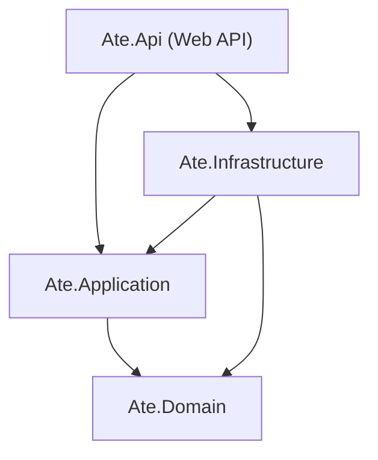

# 🏗️ Ate — Arquitectura del Backend & Especificación de Capas (.NET 10)

> **Propósito:** Este documento sirve como guía oficial de arquitectura para desarrolladores y asistentes de IA. Define la estructura de proyectos, las reglas de **Arquitectura Limpia (Clean Architecture)** y la matriz de referencias entre proyectos (`ProjectReference`).

---

## 📌 1. Visión General de la Solución

El backend de **Ate** está construido sobre **.NET 10 LTS** organizando la lógica del sistema bajo los principios de **Clean Architecture** (Arquitectura Limpia).

* **Solución de .NET:** [Ate.slnx](file:///d:/Ate/backend/Ate.slnx)
* **Directorio raíz del backend:** `d:\Ate\backend\`
* **Estrategia de Configuración & Secretos:** [docs/configuration.md](file:///d:/Ate/backend/docs/configuration.md)

---

## 📁 2. Estructura de Proyectos

```text
d:\Ate\backend\
 ├── Ate.slnx                        --> Solución unificada de .NET 10
 │
 ├── Ate.Domain/                     --> Capa de Dominio (Pura)
 │    └── Ate.Domain.csproj
 │
 ├── Ate.Application/                --> Capa de Casos de Uso y Reglas de Negocio
 │    └── Ate.Application.csproj
 │
 ├── Ate.Infrastructure/             --> Capa de Persistencia e Infraestructura
 │    └── Ate.Infrastructure.csproj
 │
 └── Ate.Api/                        --> Capa de Presentación (Web API / Controllers)
      └── Ate.Api.csproj
```

---

## 🔗 3. Matriz de Referencias entre Proyectos (`ProjectReference`)

En Arquitectura Limpia, **las dependencias apuntan hacia adentro**, siendo el **Dominio** la capa más interna e independiente de todas.



### Detalle de Proyectos y Referencias:

| Proyecto | Tipo | Referencias (`ProjectReference`) | Descripción & Responsabilidad |
| :--- | :--- | :--- | :--- |
| **`Ate.Domain`** | `classlib` | **Ninguna (0 dependencias)** | Contiene las entidades principales (pendientes de definir), Enums, Value Objects y excepciones del dominio. No conoce bases de datos ni APIs. |
| **`Ate.Application`** | `classlib` | `Ate.Domain` | Contiene interfaces (`IApplicationDbContext`, `IJwtProvider`), DTOs, validaciones y servicios de casos de uso. |
| **`Ate.Infrastructure`** | `classlib` | `Ate.Application`, `Ate.Domain` | Implementa el acceso a datos (`DbContext` con Entity Framework Core), repositorios, proveedores de tokens JWT y servicios de códigos QR. |
| **`Ate.Api`** | `webapi` | `Ate.Application`, `Ate.Infrastructure` | Expone los endpoints HTTP REST, configura middlewares (CORS, JWT, Excepciones) y registra las dependencias en el contenedor de IoC. |

---

## 🗄️ 4. Especificación de Base de Datos & ORM

* **Motor de Base de Datos:** **PostgreSQL 16 LTS** *(Versión estable recomendada para producción y desarrollo)*.
* **ORM:** **Entity Framework Core (EF Core 10)**.
* **Proveedor EF Core / Driver:** `Npgsql.EntityFrameworkCore.PostgreSQL` v10.0.3.

### 📦 Paquetes NuGet Instalados:
| Proyecto | Paquete NuGet | Versión | Propósito |
| :--- | :--- | :--- | :--- |
| **`Ate.Infrastructure`** | `Npgsql.EntityFrameworkCore.PostgreSQL` | `10.0.3` | Proveedor ORM de EF Core para conectar y mapear con PostgreSQL. |
| **`Ate.Api`** | `Microsoft.EntityFrameworkCore.Design` | `10.0.12` | Herramientas en tiempo de diseño para la creación y ejecución de Migraciones (`dotnet ef migrations`). |

---

## 🛠️ 5. Comandos de la CLI de .NET & EF Core

### Compilar toda la solución:
```bash
dotnet build backend/Ate.slnx
```

### Ejecutar la Web API con recarga en vivo:
```bash
dotnet watch --project backend/Ate.Api/Ate.Api.csproj
```

### Crear una nueva migración de base de datos:
```bash
dotnet ef migrations add <NombreMigracion> --project backend/Ate.Infrastructure/Ate.Infrastructure.csproj --startup-project backend/Ate.Api/Ate.Api.csproj
```

### Aplicar migraciones a la base de datos PostgreSQL:
```bash
dotnet ef database update --project backend/Ate.Infrastructure/Ate.Infrastructure.csproj --startup-project backend/Ate.Api/Ate.Api.csproj
```

---

## 🎯 6. Reglas de Desarrollo para Desarrolladores & IA

1. **Inversión de Dependencias:** La capa `Ate.Application` define las **interfaces**, y `Ate.Infrastructure` implementa dichas interfaces (`AteDbContext`).
2. **Sin dependencias circulares:** Ningún proyecto de capa interna (`Domain` o `Application`) puede hacer referencia a capas externas (`Infrastructure` o `Api`).
3. **Estilo de Código:** Utilizar **TypeScript/C# con tipado estricto**, manejo de nulos habilitado (`<Nullable>enable</Nullable>`) y registros `record` o clases inmutables cuando aplique.
4. **Convención de Base de Datos:** Todos los nombres de tablas, columnas, índices y restricciones **DEBEN estar en INGLÉS**.

---

## 🛡️ 7. Manejo Estándar de Errores & Lógica de Negocio

El backend de **Ate** implementa la mejor práctica de la industria para el control de errores, dividiéndolos estrictamente en dos categorías:

### 1. Errores Esperados (Negocio, No Encontrado, Validación, Autorización)
* **Patrón Utilizado:** **Result Pattern** (*Railway-Oriented Programming*).
* **Ubicación:** `Ate.Domain.Common` (`Result`, `Result<T>`, `Error`, `ErrorType`).
* **Regla:** **PROHIBIDO** lanzar excepciones (`throw new ...`) para flujos esperados de negocio o validación (ej. usuario no existe, contraseña incorrecta, saldo insuficiente). Todo caso de uso o servicio debe retornar `Task<Result<T>>` o `Task<Result>`.

#### Categorías de Errores (`ErrorType`):
| Tipo (`ErrorType`) | Código HTTP | Descripción | Ejemplo de Código |
| :--- | :--- | :--- | :--- |
| **`NotFound`** | `404 Not Found` | El recurso solicitado no existe en el sistema. | `Error.NotFound<Company>(id)` |
| **`Validation`** | `400 Bad Request` | Carga útil o campos con datos inválidos o faltantes. | `Error.Validation<User>("Invalid format")` |
| **`Unauthorized`** | `401 Unauthorized` | Fallo de identidad o credenciales erróneas. | `AuthErrors.InvalidCredentials` |
| **`Forbidden`** | `403 Forbidden` | Identidad válida pero estado bloqueado o inactivo. | `AuthErrors.UserInactive` |
| **`Conflict`** | `409 Conflict` | Conflicto de estado (ej. duplicidad de documento/cédula/RUC). | `Error.Conflict<Company>("RUC", ruc)` |
| **`Failure`** | `422 Unprocessable` / `400` | Violación de regla o invariante de negocio. | `Error.Failure("Code", "Description")` |

#### 💡 Fábrica Genérica Reutilizable (Cero Clases Basura):
Para evitar crear clases estáticas dedicadas por cada entidad (`CompanyErrors`, `ProductErrors`), se utilizan las fábricas genéricas directamente en `Error`:
* `Error.NotFound<TEntity>(id)` ➔ Genera: Code: `"Company.NotFound"`, Description: `"Company with identifier '123' was not found."`
* `Error.NotFound(name, id)` ➔ Mismo comportamiento pasando el nombre como string.
* `Error.Conflict<TEntity>(field, value)` ➔ Genera: Code: `"User.Conflict"`, Description: `"User with DocumentNumber '12345' already exists."`

#### Mapeo a HTTP y `ApiResponse<T>`:
En la capa de API (`Ate.Api.Controllers`), se utiliza la extensión `result.ToActionResult(this)`:
```csharp
[HttpPost("login")]
public async Task<IActionResult> Login([FromBody] LoginRequest request, CancellationToken cancellationToken)
{
    var result = await _authService.LoginAsync(request, cancellationToken);
    return result.ToActionResult(this, "User authenticated successfully.");
}
```

---

### 2. Errores Inesperados (Crashes, Caídas de Base de Datos, Fallos de Red)
* **Patrón Utilizado:** **Global Exception Handler** nativo de .NET (`IExceptionHandler`).
* **Ubicación:** `Ate.Api.Middlewares.GlobalExceptionHandler`.
* **Registro:** Configurado en `DependencyInjection.cs` y activado en `Program.cs` con `app.UseExceptionHandler()`.
* **Comportamiento:**
  * En desarrollo: expone el mensaje y tipo de excepción en el array de errores de `ApiResponse<T>`.
  * En producción: oculta detalles sensibles del sistema y retorna de manera segura `HTTP 500 Internal Server Error` con el contrato unificado `ApiResponse<object>.FailureResponse("An unexpected server error occurred. Please try again later.")`.


